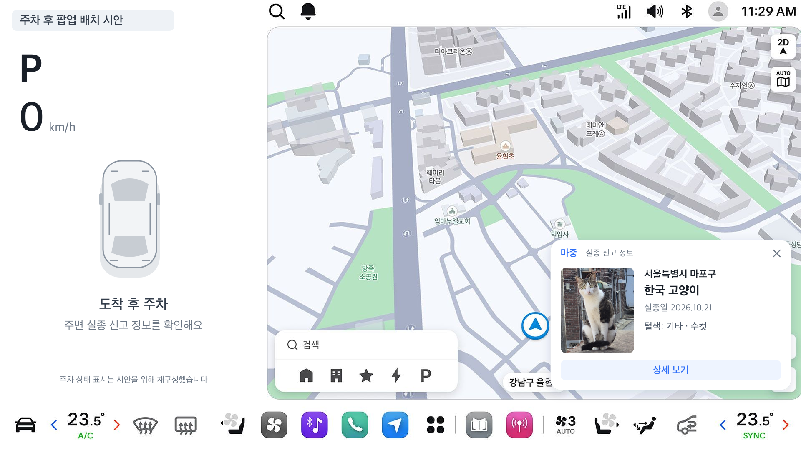

# 마중

**목적지에 도착해 주차한 뒤, 그 지역의 분실 반려동물 공고를 사진으로 확인하는 Pleos 앱.**

주행 중에는 공고와 연락처를 가립니다. 실제 내비 도착 신호와 신선한 P 기어·속도 0·UX 허용 상태를 확인한 뒤, 사진이 준비되면 6초 동안 작은 하단 안내를 표시하도록 구현했습니다. 현재 실제 Pleos의 도착부터 사진 안내까지 이어지는 통합 시험은 완료하지 못했습니다.

## 실제 공고 적용 시안

2026년 11월 15일 23:07 KST에 실제 API로 조회한 마포구 한국 고양이 공고와 사진을 적용했습니다. 주차 후 우측 하단에 전체 화면 면적의 10% 크기로 표시하는 **배치 시안**이며, 실제 SDK 자동 표시 캡처는 아닙니다. 내비 배경은 강남구, 공고는 마포구로 같은 시도 조회 사례입니다. 같은 구나 근거리 자동 매칭 결과를 뜻하지 않습니다.



[조회 기록·시안 출처·구현 범위](review/README.md)에서 적용한 공고와 실종일을 확인할 수 있습니다. 실시간 조회에는 아래 안내대로 인증키를 설정한 로컬 백엔드가 필요합니다.

## 빠르게 실행하기

Python 3.12+, Node.js 22+가 필요합니다. 웹은 프레임워크와 npm 의존성이 없습니다.

```sh
python3 -m venv .venv
. .venv/bin/activate
python -m pip install -r requirements.txt
python scripts/run_local.py --demo
```

브라우저에서 `http://127.0.0.1:8787/`을 엽니다. 체험 모드에서 **이동 시작 → 목적지 도착 → P단 주차**를 조작할 수 있습니다. 이 버튼은 모의 상태이며 실제 SDK 도착을 증명하지 않습니다.

실공고를 사용하려면 `python scripts/run_local.py`로 실행하고 터미널의 숨김 입력에 공공데이터포털 **분실동물 조회 서비스** 인증키를 넣으세요. 또는 로컬 환경변수 `DATA_GO_KR_SERVICE_KEY`를 사용합니다. 인증키는 Git·APK·프론트엔드에 포함하지 않습니다. 키가 없을 때 실공고 모드는 오류를 표시하고 가상 공고로 바꾸지 않습니다.

## Pleos 설치와 빌드

- Android SDK platform 35 / build-tools 35.0.0, JDK 17+(CI JDK21)
- 공식 Pleos Connect emulator **2.1.0**, 공식 NaviHelper **3.0.5**
- 공식 Maven: `https://nexus-playground.pleos.ai/repository/maven-releases/`
- 차량 상태: Android Automotive Car API (`android.car`), SDK의 실제 paired read
- 앱 ID: `ai.nearby.reunion` / 별도 체험 앱: `ai.nearby.reunion.demo`

```sh
sh scripts/build_android.sh pleos release
adb install -r apk/TEAM_마중_release.apk
```

로컬 API 서버를 켜 두세요. Pleos flavor는 `http://10.0.2.2:8787/?platform=android&dataMode=live`에 연결합니다. 차량에서는 앱의 **도착 확인 시작**을 누르고 차량 속도·동력계·알림 권한을 허용합니다. API 서버가 없으면 번들 UI는 열리지만 실공고 조회는 사용할 수 없습니다. 이 저장소는 공개 HTTPS 백엔드가 배포된 상용 앱이 아닙니다.

빌드는 서명키를 요구하지 않으며 unsigned release가 만들어집니다. GitHub Actions도 네이티브 테스트와 unsigned release 빌드를 수행합니다. 정렬된 APK를 `scripts/sign_release.py`로 로컬 서명하며 키와 암호는 저장소 밖에 유지합니다.

**APK 위치:** [`apk/`](apk/). `TEAM`은 아직 정하지 않은 팀명 자리입니다. 접수 전에 `팀명_마중_release.apk`로 바꾸고 최종 경로·커밋을 기록하세요. 이전 진단용 APK와 새 제출 후보의 검증 범위는 `apk/README.md`에서 구분합니다.

## 기능과 확인 범위

| 항목 | 구현·확인 상태 |
| --- | --- |
| 실제 공고·사진·공개 연락처 조회 | 구현. 실 API 사진/연락처 제공을 확인했으며 원문 데이터는 저장소에 보관하지 않음 |
| 목적지 행정구역 해석 | 구현. 해석 실패 시 이전 지역·전국 공고 자동 표시 차단 |
| 실제 SDK 도착 콜백 연결 | 구현. 실제 주행 도착 콜백 수신은 아직 미검증 |
| P·속도 0·UX·신선도 gate | 구현 및 순수 로직 회귀 검사. 이전 실제 SDK P/0 수신 확인 |
| 사진 준비 후 6초 하단 안내 | 구현 및 웹 회귀 검사. Pleos 실제 도착 연계는 미검증 |
| 내비와 분할 화면 | 이전 실제 두 pane 관측. visible-paused 보완은 이번 변경이며 실기기 재검증 필요 |
| 통신·연결 오류 복구 | API 20초·내비 초기화 콜백 10초 제한, 오래된 응답/콜백 차단 |
| 앱이 완전히 뒤에 있는 경우 | 서비스의 도착 보관·알림/텍스트 안내. 내비 전체 화면 위 실사진 오버레이는 미구현 |
| 발견 완료 자동 판별 | 이번 조회 응답으로는 자동 판별할 수 없음. 새 응답에서 사라진 공고만 제외 |

최근 30일·행정구역·페이지 범위의 공고이며, 반경·정확한 거리·항상 미발견 상태를 보장하지 않습니다. 사람 실종 공고는 이번 구현 범위에 포함하지 않습니다. 연락처는 사용자가 선택한 뒤 확인하고 전화는 다이얼러만 열며 자동 발신하지 않습니다.

## 시험 환경과 결과

실제 Galaxy MacBook Air(M4/16GB)와 외장 APFS에서 공식 Pleos 2.1.0을 시험했습니다. 실제 Android 캡처는 **2560×1440**, 영상 인코딩은 별도로 **1920×1080**을 지정했습니다. density는 보존 증거에서 확인하지 못했습니다. 주행·도착·P단·사진을 함께 보여 주는 실제 연속 시연 영상은 아직 없습니다.

2026-11-12 정지 GNSS 시험에서 GPGGA 19개·GPRMC 19개의 실제 Android 콜백과 정상 체크섬을 확인했습니다. 이 입력은 합성 GNSS이며 실도로 주행이나 NaviHelper 도착 성공 증거가 아닙니다. 실제 환경은 내부 여유 공간 부족으로 중단했습니다. 기존 사용자 작업은 종료하지 않았습니다.

```sh
npm test
python -m unittest discover -s tests/backend -v
python -m unittest discover -s tests/tools -v
(cd tools/pleos-trial && perl mock_tests.pl)
```

현재 검사: 웹121/121 · 백엔드34/34 · 네이티브73/73 · Python 도구17/17 · Perl123/123 · NMEA메타데이터16/16 통과입니다.

최신 결과는 [기능 점검 보고서](docs/functional-audit-2026-11-13.md), [소스 복구·기존 시험 증거](docs/source-provenance.md), [진단 도구](tools/README.md), GitHub Actions에서 확인할 수 있습니다. 자동화 테스트 통과와 실제 차량/SDK 통합 성공은 별개입니다.

## 구성

- `web/`: 현재 실행 진입점 `index.html` → `app-contest.js`, `model-contest.js`, `arrival-banner-contest.js`. 접미사 없는 파일은 이전 구현 호환 자료이며 현재 진입점이 아닙니다.
- `backend/`: 공공데이터 중계, 지역/품종 해석, 메모리 캐시, 제한된 사진 프록시
- `apps/android/`: Pleos·demo flavor, 실제 SDK 연결, 서비스·차량 gate·WebView
- `tests/`: 현행 모듈에 대한 웹·백엔드·도구 검사
- `tools/`: 자원 가드가 있는 외장 에뮬레이터 진단, 5분 제한 NMEA observer
- `docs/submission/`: 서명 전 접수 초안과 제출 점검표
- `apk/`: 서명된 release APK와 검증 기록

SDK·AVD·캐시·서명키·API키·실공고 원문·원격 접속 정보는 업로드하지 않습니다. 공식 SDK는 Gradle이 공식 저장소에서 받습니다.

## 공모전 제출

공식 제출 안내: https://appdevchallenge.auto-hmg.io/guide/submission

접수양식/팀원 동의·서명·날짜가 필요하며 메일 제출은 별도입니다. GitHub 업로드는 접수 완료가 아닙니다. 비공개 저장소는 11월 16일까지 공개로 전환하고 11월 23일까지 유지해야 개발 산출물 가산점 조건을 충족합니다. 공개 전환은 이 작업에서 수행하지 않았습니다. 최종 제출에는 저장소 URL과 최종 commit hash를 적으세요.
